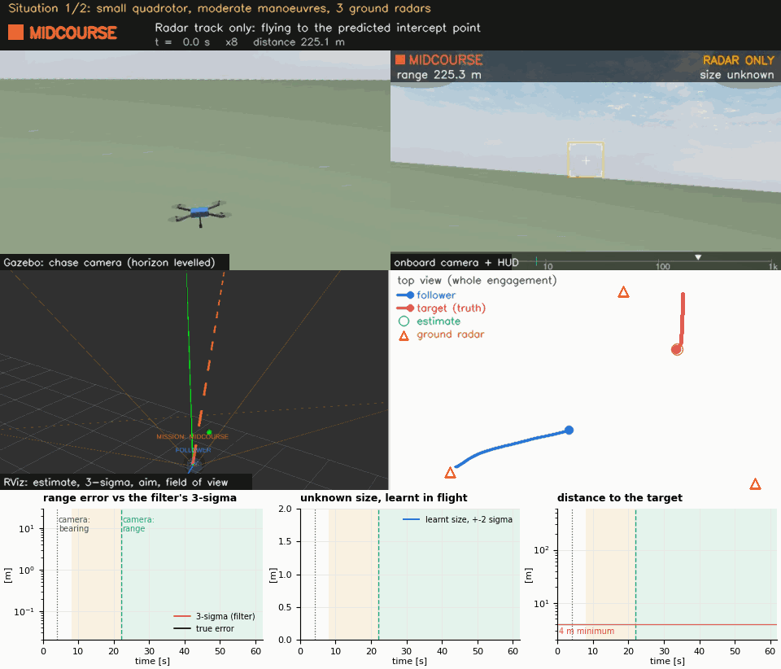
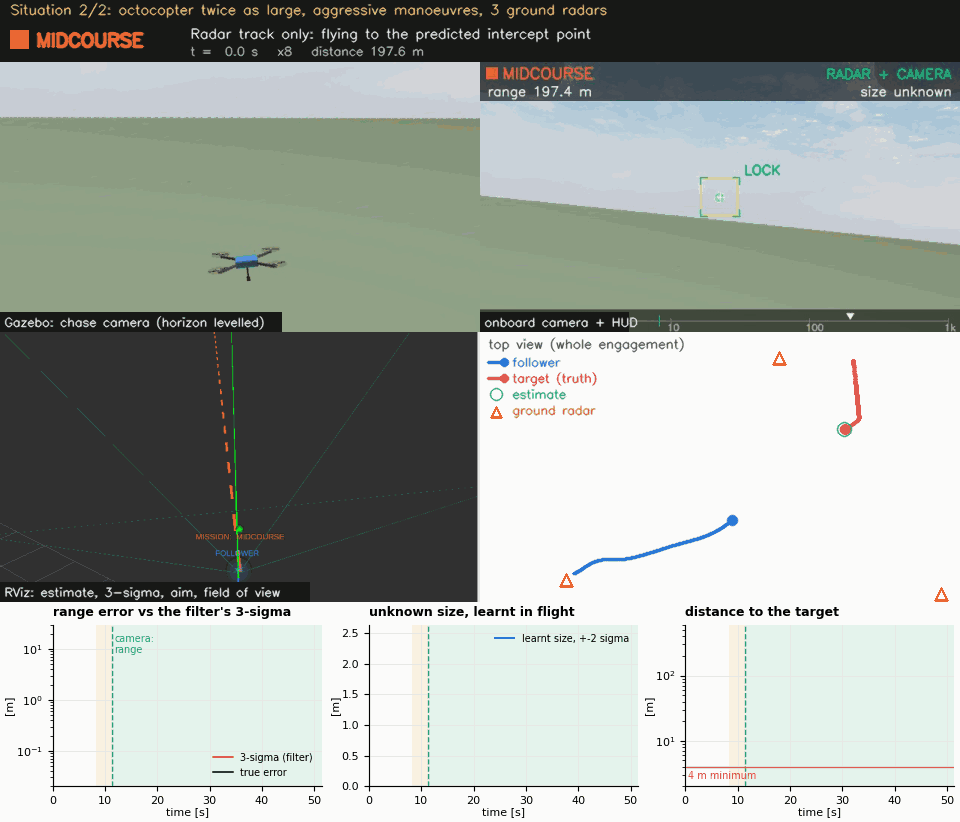
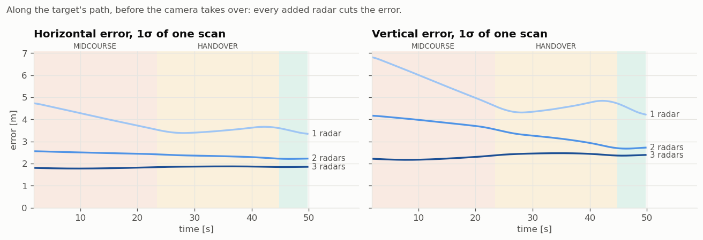
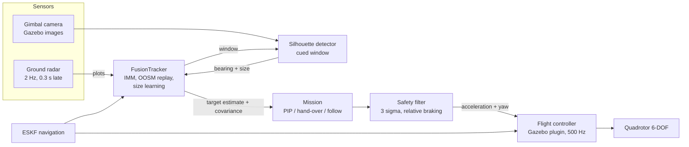

# Drone Follow-Me: radar-cued interception of an unknown drone

[](https://github.com/NicoC54/Drone-Follow-Me-Project/actions/workflows/ci.yml)
  

A ground radar picks up an **unknown drone** 480 m away. A quadrotor flies to the predicted
intercept point, hands over to its own camera, **learns the target's size in flight**, then follows
it at a safe distance. Everything between the sensors and the motors is written here, in C++.

Two Gazebo flights. Each GIF shows ONE flight: chase camera (horizon levelled), onboard camera
with HUD, RViz, top view, and the same flight's estimation plots: range error along the line of
sight against the filter's own 3σ on that axis, the unknown target size learnt in flight, and the
distance to the target. Playback speed varies with the phase (x8 mid-course, x4 hand-over, x2
around the camera lock, x4 follow) and is marked on the plots, whose time axis is flight time.





*Random flight plans (`target_path:=random`, seeds 8 and 47): straight legs and decisive turns,
stops and sprints; the follower never knows the target's shape, size or route. Minimum distance
6.3 m and 5.9 m. In FOLLOW the range error stays under the filter's 3σ 96 % of the time in
situation 1, but only 78 % against the aggressive octocopter: the filter is somewhat
over-confident against a target as agile as the follower (a known limit).
**▶ [1-minute video](docs/media/demo.mp4)** (an earlier scripted flight, hexacopter).*

**[Interactive 3D replay](https://nicoc54.github.io/Drone-Follow-Me-Project/replay/)** ·
**[Results](docs/RESULTS.md)** · **[Usage](docs/USAGE.md)** · **[Design decisions](DESIGN.md)** ·
**[Course (FR)](docs/cours/00_INDEX.md)**

## What is built from scratch

- **Flight**: 6-DOF quadrotor, flight controller (thrust vector, quaternion attitude, PI rates,
  mixer with desaturation) as a Gazebo plugin at 500 Hz, **15-state ESKF** on IMU/GNSS/baro/mag.
- **Tracking**: **1-3 ground radars** (trilateration) + camera fusion with **exact out-of-sequence replay**, own-echo rejection,
  M-of-N track start, **IMM**, unknown target size learnt online, chi2 gating.
- **Guidance**: mission state machine, **predicted-intercept-point** guidance, hand-over driven by
  range uncertainty, follow guidance with bumpless entry and an **agility-scaled standoff**, **CBF-like safety filter** on the
  estimate's uncertainty.
- **Vision**: silhouette detector in the radar-cued window, aspect-invariant apparent size.
- **Validation**: 52 tests, offline simulator (a run in ~0.1 s), **Monte-Carlo campaigns**,
  random target flights in Gazebo too (one seed replays a run), ground-truth diagnosis tools.

## Key results

| | |
|---|---|
| 300 randomised interceptions (offline) | **300/300** reach follow, **0** below 4 m |
| Random target manoeuvres, moderate / aggressive | 4 / **31** runs out of 300 below 4 m (aggressive, in FOLLOW: 37 → 13 with the agility-scaled standoff) |
| Gazebo, physical target (rendered images) | estimate error **0.49 m**, min distance 5.0 m |
| Gazebo phase-4 gap, after ground-truth diagnosis | error 1.36 → 0.26 m, NEES 37 → 7.5 |
| 1 → 3 ground radars (trilateration), radar-phase error | horizontal 2.4 → **0.9 m**, vertical 3.2 → **1.5 m** |

## Gallery

| | |
|---|---|
|  |  |
| **Distance** (log scale): 480 m → 8-10 m standoff (agility-scaled), never below the 4 m minimum. Bands = mission phases. | **300 randomised interceptions**: minimum distance, time to follow, follow quality. |

**More ground radars, better radar phase.** A radar measures range precisely (2 m) but angles
coarsely (0.5°, 0.8°). Sites seen from different directions cross their ranges, which removes the
angle error. The gain matters until the camera takes over, not after:



Estimation details, random manoeuvres, radar maps, every radar plot: [docs/RESULTS.md](docs/RESULTS.md).

## Architecture



The algorithms live in a ROS-free C++ library (`ros2_ws/src/follow_me_core`), used by the
offline simulator, the unit tests and the ROS 2 nodes alike.

## Quick start

```bash
cd ros2_ws && source /opt/ros/jazzy/setup.bash
colcon build && colcon test && colcon test-result
source install/setup.bash
ros2 launch follow_me_gazebo intercept.launch.py                     # Gazebo + RViz, random target model
ros2 launch follow_me_gazebo intercept.launch.py radars:=3           # three ground radars
ros2 launch follow_me_gazebo intercept.launch.py target_path:=random # random target flight
./build/follow_me_core/follow_me_offline_sim --intercept --montecarlo 300 --out ../out   # no ROS
```

All commands (phase 1-3 scenarios, figures, Foxglove, diagnosis tools): [docs/USAGE.md](docs/USAGE.md).
