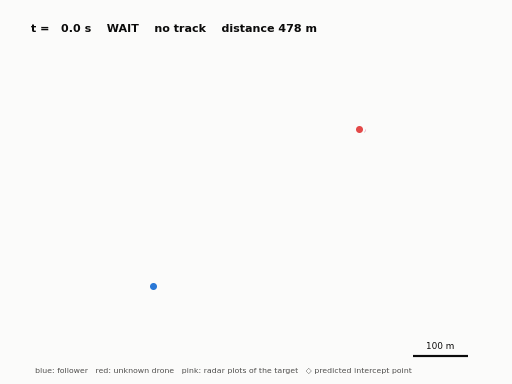
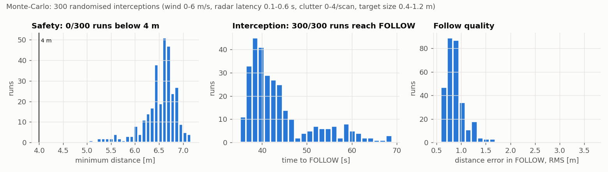

# drone-follow-me

Teaching GNC project: a follower drone intercepts an unknown drone picked up by a ground radar,
hands over to its own camera, learns the target's size, then follows it at a safe distance.
C++17 / ROS 2 Jazzy / Gazebo Harmonic, with a 6-DOF quadrotor flown by its own flight controller.



**[Interactive 3D replay](https://nicoc54.github.io/Drone-Follow-Me-Project/replay/)** (three.js, runs in the browser)

| | |
|---|---|
|  |  |


**300 randomised runs** (wind 0-6 m/s, radar latency 0.1-0.6 s, clutter 0-4 plots/scan, target
size 0.4-1.2 m): 300/300 reach FOLLOW, 0 below the 4 m minimum distance (worst 5.3 m),
FOLLOW after 39 ± 13 s, median follow distance error 0.78 m RMS.



The project grew in four phases (each one documented in [docs/cours/](docs/cours/00_INDEX.md), French):
1. Python sandbox: camera on a red beacon, EKF, guidance, control, safety filter.
2. C++ / ROS 2 / Gazebo: the same algorithms on real rendered images.
3. Real quadrotor: own flight controller (Gazebo plugin) + 15-state ESKF navigation.
4. Ground radar + predicted-intercept-point guidance + camera hand-over on an unknown drone.

The original phase-1 chain, kept deliberately small:

```
truth (leader + follower)                                    vehicles.py
   -> camera: pixel position + apparent size, noise,         camera.py
      missed and false detections
   -> EKF on the leader [p, v] + gating + track management   estimation.py
   -> guidance: follow point 8 m behind / 2 m above          guidance.py
   -> control: cascaded P/PI + separation safety filter      control.py
   -> follower point-mass dynamics (lag, drag, wind, gusts)  vehicles.py
```

Two implementations:
- **Python** (`follow_me/`): compact reference and sandbox, matplotlib plots.
- **C++ / ROS 2 Jazzy / Gazebo Harmonic** (`ros2_ws/`): the same algorithms in a C++ library,
  wrapped in ROS 2 nodes, with real camera images rendered by Gazebo. The follower is a 6-DOF
  quadrotor flown by its own flight controller (Gazebo plugin: 15-state ESKF navigation on
  IMU/GNSS/baro/mag + attitude/rate control + mixer).
  See [docs/UNDERSTANDING_ROS.md](docs/UNDERSTANDING_ROS.md) and
  [docs/UNDERSTANDING_FLIGHT.md](docs/UNDERSTANDING_FLIGHT.md).

Learning sheets (French): [docs/UNDERSTANDING.md](docs/UNDERSTANDING.md) (Python, GNC principles),
[docs/UNDERSTANDING_ROS.md](docs/UNDERSTANDING_ROS.md) (C++ / ROS 2 / Gazebo),
[docs/UNDERSTANDING_FLIGHT.md](docs/UNDERSTANDING_FLIGHT.md) (quadrotor, flight controller, navigation).

The Python loop is in `follow_me/sim.py` and every parameter is in `follow_me/config.py`.
Design choices and their reasons are in [DESIGN.md](DESIGN.md).

## Run

Requirements: Python 3.10+, numpy, matplotlib (pytest for the tests).

```bash
python -m follow_me                       # metrics + 3 figures
python -m follow_me --animate             # + top-view animation
python -m follow_me --occlusion 40 46     # blind the camera: COAST -> SEARCH -> reacquire
python -m follow_me --seed 3 --no-plots --save out/   # headless, figures to out/
python -m pytest tests
```

## Run the C++ / ROS 2 / Gazebo version

```bash
cd ros2_ws
source /opt/ros/jazzy/setup.bash
colcon build && colcon test && colcon test-result --verbose
source install/setup.bash
ros2 launch follow_me_gazebo follow_me.launch.py                 # Gazebo + RViz
ros2 launch follow_me_gazebo follow_me.launch.py p_miss:=0.1 p_outlier:=0.02
./build/follow_me_core/follow_me_offline_sim --seed 3            # C++ offline sim, no ROS
./build/follow_me_core/follow_me_offline_sim --perfect-nav       # same, with perfect navigation

# phase 4: radar-cued interception of an unknown drone
ros2 launch follow_me_gazebo intercept.launch.py                 # Gazebo + RViz (+ foxglove:=true)
./build/follow_me_core/follow_me_offline_sim --intercept --seed 2 --out ../out
./build/follow_me_core/follow_me_offline_sim --intercept --montecarlo 300 --seed 7 --out ../out
```

### Figures, GIF, web replay, Foxglove

```bash
python3 tools/make_figures.py out/ docs/media/      # README figures + GIF + docs/replay/replay.json
python3 -m http.server -d docs 8000                 # then http://localhost:8000/replay/
tools/record_demo.sh out/demo                       # MCAP recording of a running launch (Ctrl+C)
python3 tools/gen_world_extras.py                   # regenerate propellers + scenery in the worlds
```

- RViz shows the algorithms: predicted intercept point, approach line, predicted target path,
  camera field of view, 3σ ellipsoids of the estimate and of every radar plot.
- The camera panel shows a HUD (`hud_node`): mission phase, range, track source, learnt size, lock.
- Foxglove Studio: `sudo apt install ros-jazzy-foxglove-bridge`, launch with `foxglove:=true`, open
  `ws://localhost:8765` and import [docs/foxglove/follow_me_layout.json](docs/foxglove/follow_me_layout.json)
  (also works on an MCAP recording).

## What to look at (Python)

| Figure | What it teaches |
|---|---|
| Overview, separation | distance vs setpoint and `d_min`; grey/yellow bands = SEARCH/COAST |
| Estimation, errors vs ±3σ | is the EKF consistent? (errors should stay inside the bounds, NEES ≈ 6) |
| Estimation, NIS | the chi2 gate separating real detections from false ones |
| Camera & control, image plane | where the leader sits in the image, outliers |
| Camera & control, a_cmd | how estimation noise propagates into the commands |

## Experiments to try

- `estimator.q_accel`: 0.3 vs 1.5 vs 10. Lag in turns vs noisy commands.
- `camera.sigma_size_px` × 5: range becomes poor; watch the ±3σ bands and the distance error.
- `control.ki = 0`: steady lag behind a moving leader (drag + wind).
- `guidance.follow_dist = 5`: the safety filter starts working in the turns and stops.
- `estimator.gate_chi2 = 1e9` (no gating): what the outliers do to the estimate.
- `--occlusion 70 73` during the sharp turn: how fast the constant-velocity prediction diverges.
