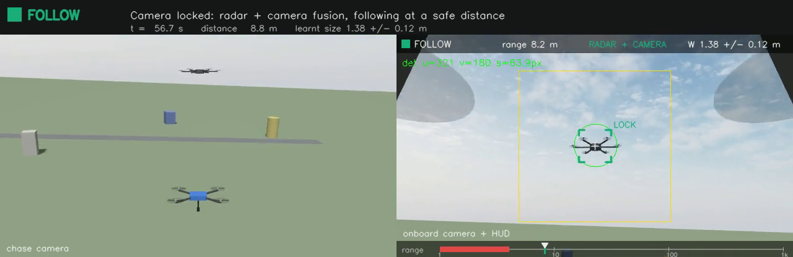
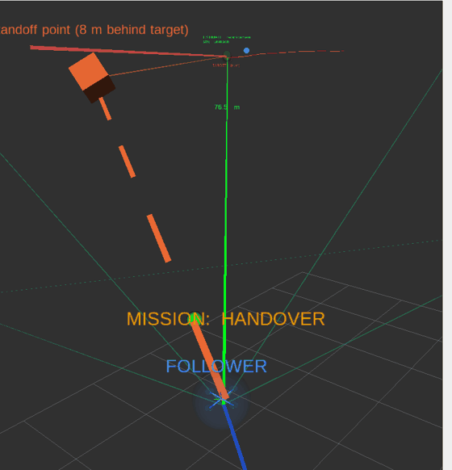
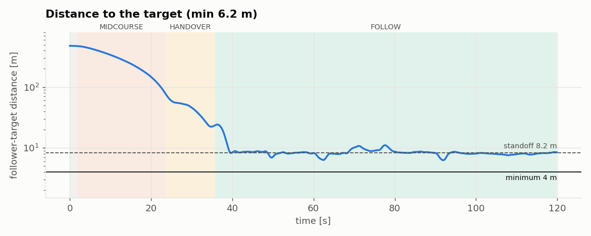
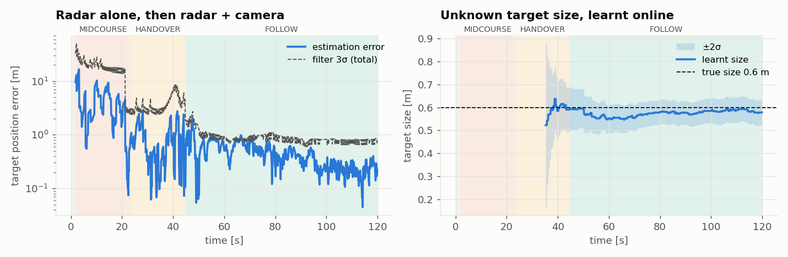
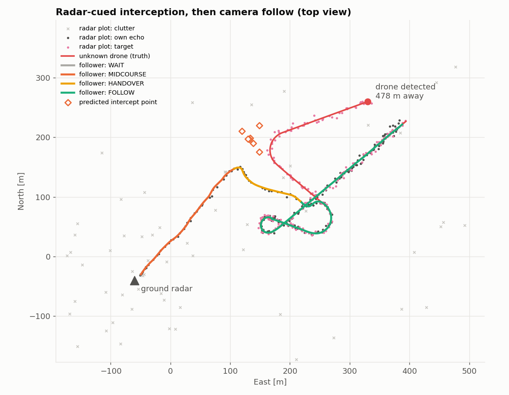
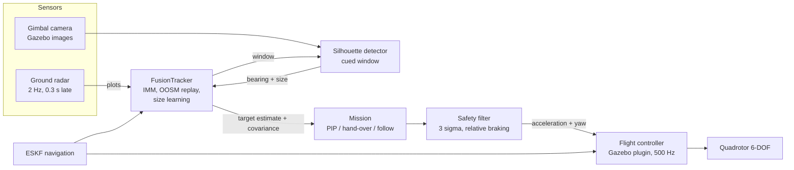

# Drone Follow-Me: radar-cued interception of an unknown drone

[](https://github.com/NicoC54/Drone-Follow-Me-Project/actions/workflows/ci.yml)
  

A ground radar picks up an **unknown drone** 480 m away. A quadrotor flies to the predicted
intercept point, hands over to its own camera, **learns the target's size in flight**, then follows
it at a safe distance. Everything between the sensors and the motors is written here, in C++.


| Gazebo: chase camera + onboard camera with HUD | RViz: what the algorithms see |
|---|---|
| [](docs/media/demo.mp4) |  |
| **▶ [1-minute demo video](docs/media/demo.mp4)**: unknown hexacopter, radar cueing, camera lock, follow. | Follower (blue) and target truth (red) with their tracks; target **estimate** and its 3σ ellipsoid (orange: radar only, green: radar + camera); aim point and approach line (mid-course: predicted intercept point; hand-over: standoff point 8 m behind the target); camera field of view; true distance on the link (green → red near 4 m); mission phase. |

**[Interactive 3D replay](https://nicoc54.github.io/Drone-Follow-Me-Project/replay/)** ·
**[Results](docs/RESULTS.md)** · **[Usage](docs/USAGE.md)** · **[Design decisions](DESIGN.md)** ·
**[Course (FR)](docs/cours/00_INDEX.md)**

## What is built from scratch

- **Flight**: 6-DOF quadrotor, flight controller (thrust vector, quaternion attitude, PI rates,
  mixer with desaturation) as a Gazebo plugin at 500 Hz, **15-state ESKF** on IMU/GNSS/baro/mag.
- **Tracking**: **1-3 ground radars** (trilateration) + camera fusion with **exact out-of-sequence replay**, own-echo rejection,
  M-of-N track start, **IMM**, unknown target size learnt online, chi2 gating.
- **Guidance**: mission state machine, **predicted-intercept-point** guidance, hand-over driven by
  range uncertainty, follow guidance, **CBF-like safety filter** on the estimate's uncertainty.
- **Vision**: silhouette detector in the radar-cued window, aspect-invariant apparent size.
- **Validation**: 48 tests, offline simulator (a run in ~0.1 s), **Monte-Carlo campaigns**,
  ground-truth diagnosis tools for Gazebo.

## Key results

| | |
|---|---|
| 300 randomised interceptions (offline) | **300/300** reach follow, **0** below 4 m |
| Random target manoeuvres, moderate / aggressive | 4 / 49 runs out of 300 below 4 m |
| Gazebo, physical target (rendered images) | estimate error **0.49 m**, min distance 5.0 m |
| Gazebo phase-4 gap, after ground-truth diagnosis | error 1.36 → 0.26 m, NEES 37 → 7.5 |
| 1 → 3 ground radars (trilateration), radar-phase error | horizontal 2.4 → **0.9 m**, vertical 3.2 → **1.5 m** |

## Gallery

| | |
|---|---|
|  |  |
| **Distance** (log scale): 480 m → 8 m standoff, never below the 4 m minimum. Bands = mission phases. | **Estimation**: radar alone (metres), then radar + camera (decimetres) inside the filter's 3σ; the unknown target size is learnt in flight. |
|  |  |
| **300 randomised interceptions**: minimum distance, time to follow, follow quality. | **Random target manoeuvres**: safety and filter consistency (NEES, ideal 6) by target agility. |

One to three ground radars: ranges are precise, angles coarse; crossing sites trilaterate, and a
site close to the area also fixes the altitude (1σ error of one scan, analytic):


Top view of the same flight, with every radar plot (target, own echo, clutter):



Details and all figures: [docs/RESULTS.md](docs/RESULTS.md).

## Architecture



The algorithms live in a ROS-free C++ library (`ros2_ws/src/follow_me_core`), used by the
offline simulator, the unit tests and the ROS 2 nodes alike.

## Quick start

```bash
cd ros2_ws && source /opt/ros/jazzy/setup.bash
colcon build && colcon test && colcon test-result
source install/setup.bash
ros2 launch follow_me_gazebo intercept.launch.py                     # Gazebo + RViz, random target
ros2 launch follow_me_gazebo intercept.launch.py radars:=3           # three ground radars
./build/follow_me_core/follow_me_offline_sim --intercept --montecarlo 300 --out ../out   # no ROS
```

All commands (phase 1-3 scenarios, figures, Foxglove, diagnosis tools): [docs/USAGE.md](docs/USAGE.md).
