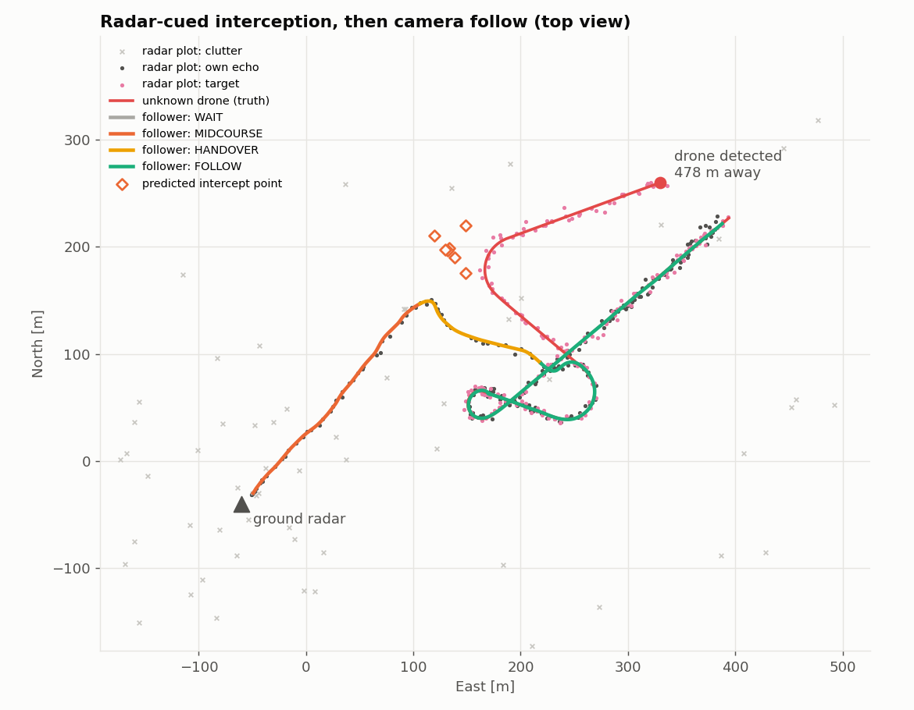
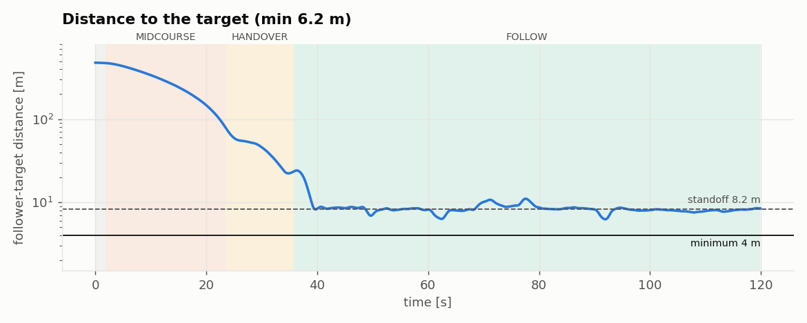
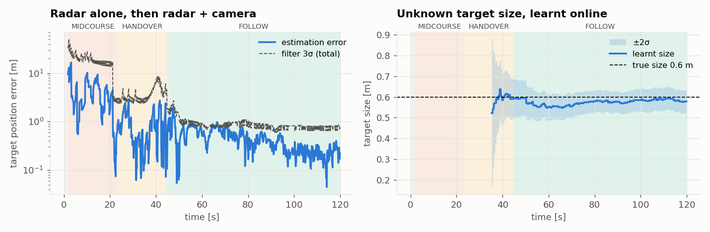
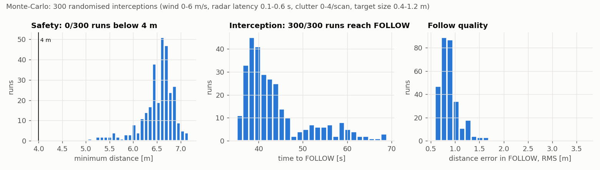
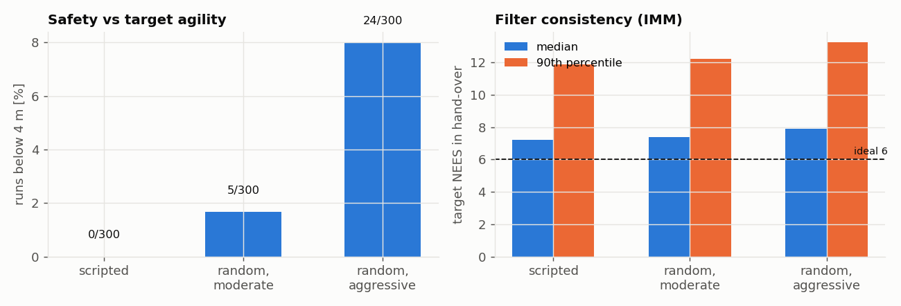
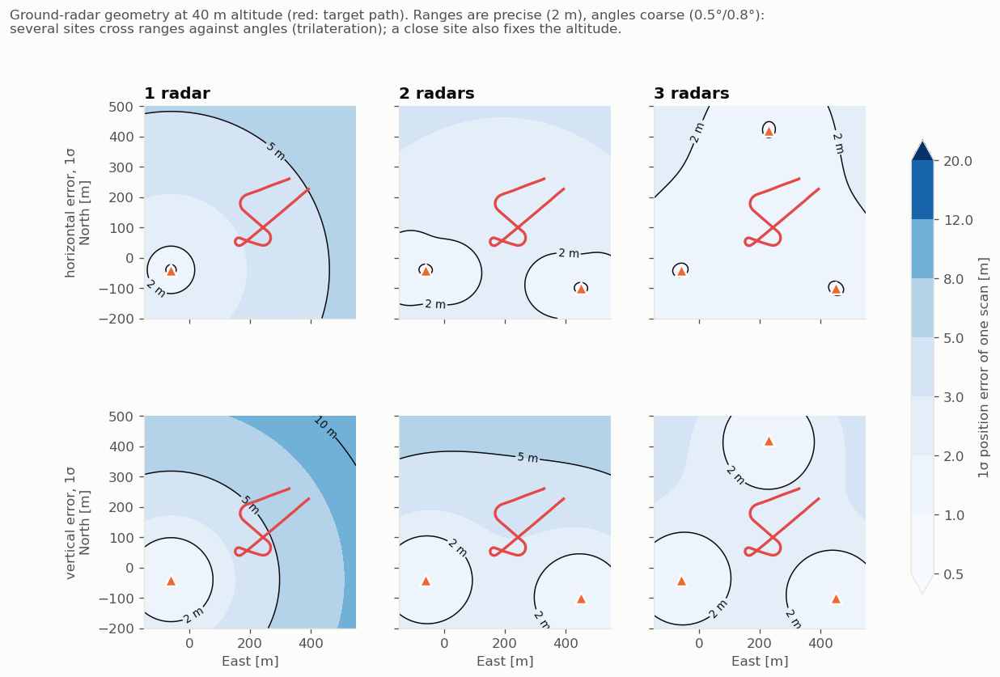
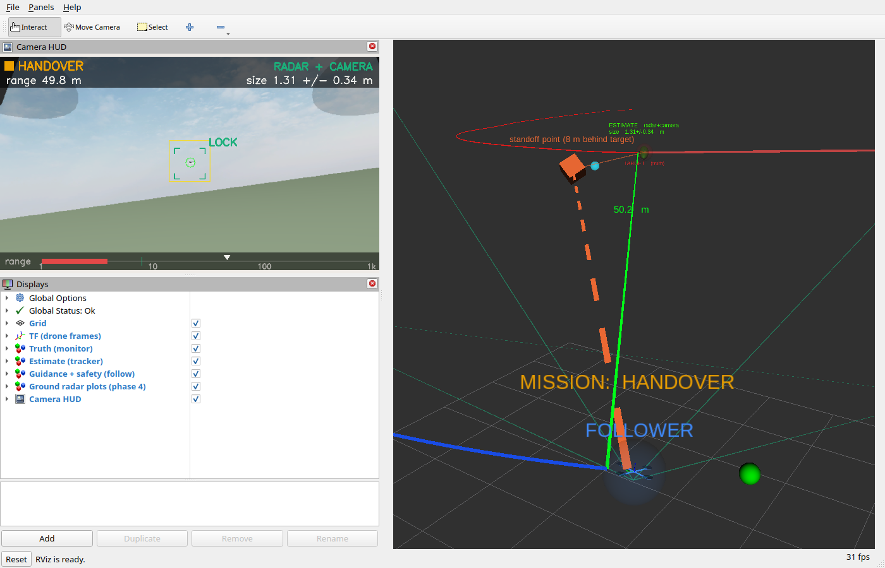
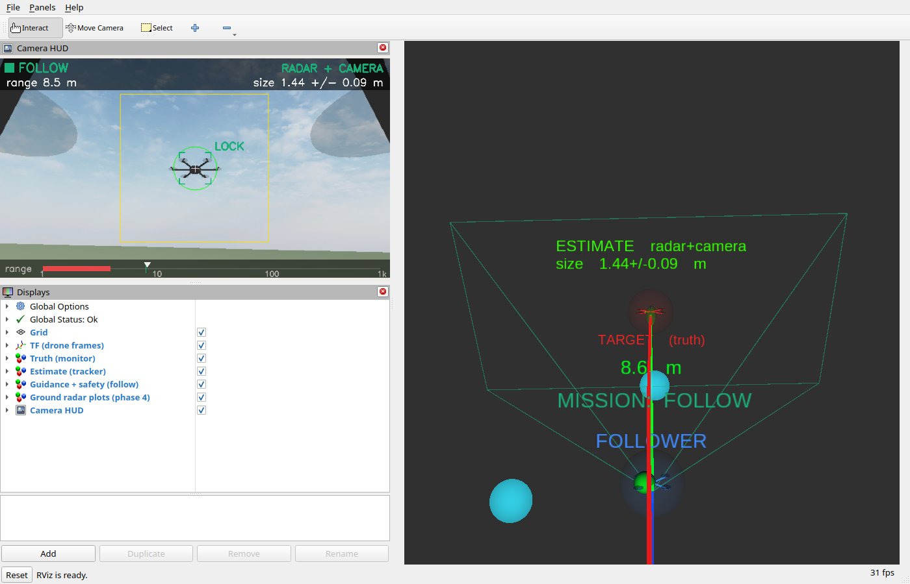

# Results

Back to the [README](../README.md). Every figure is generated from the simulator logs by
`tools/make_figures.py` (see [USAGE.md](USAGE.md)); design decisions are in [DESIGN.md](../DESIGN.md).

## One interception (offline simulator, seed 2)

| | |
|---|---|
|  |  |

[Interactive 3D replay](https://nicoc54.github.io/Drone-Follow-Me-Project/replay/) of the same run.

## Monte-Carlo: 300 randomised interceptions

Wind 0-6 m/s, radar latency 0.1-0.6 s, clutter 0-4 plots/scan, target size 0.4-1.2 m, the target
being a real quadrotor that tilts and is pushed by the wind: 300/300 reach FOLLOW, 0 below the
4 m minimum distance (worst 5.0 m), FOLLOW after 44 ± 7 s, median follow distance error 0.85 m RMS.

## Random target manoeuvres (300 runs per level)

The IMM keeps the filter consistent; safety holds against a moderately agile target (4/300 runs
below 4 m) but not against one as agile as the follower itself (49/300): a documented limit
([DESIGN.md](../DESIGN.md) D39).

## One, two or three ground radars (300 runs per level)

| Radars | Radar-phase error, horizontal / vertical | FOLLOW reached (scripted) | Runs below 4 m (scripted / moderate / aggressive) |
|---|---|---|---|
| 1 | 2.4 / 3.2 m | 41 s | 0 / 6 / 45 |
| 2 | 1.1 / 2.7 m | 38 s | 0 / 4 / 35 |
| 3 | **0.9 / 1.5 m** | **36 s** | 0 / 2 / 24 |

Two ground radars halve the horizontal error but barely help the altitude: both see the target at
a low elevation (vertical dilution of precision). A third site close to the engagement area does.
Gazebo, `radars:=3`: mid-course estimate error 1-3 m instead of 4-6 m, FOLLOW at 37 s instead of 43 s.

## Gazebo (rendered images, own flight controller, physical target)

| Hand-over (radar-cued camera, PIP guidance) | Follow (camera locked, field of view and estimate) |
|---|---|
|  |  |

| Target | Estimate error | NEES (ideal 6) | Min distance |
|---|---|---|---|
| quad x1, kinematic | 0.26 m | 7.5 | 6.6 m |
| quad x1, physical (tilts up to 27 deg) | 0.49 m | 12.6 | 5.0 m |
| octo x0.7 | 0.43 m | 9 | 6.7 m |
| hexa x1.5 (2.2 m span) | - | - | 7.8 m |

The Gazebo gap (1.36 m, NEES 37) was closed by a ground-truth diagnosis (D36): aspect-invariant
apparent size, resolution-aware size learning, bearing updates that cannot fake a range. The
remaining bias with the physical target is the lag of a constant-velocity model when the target
accelerates (D42): next step, a constant-acceleration model in the IMM.
